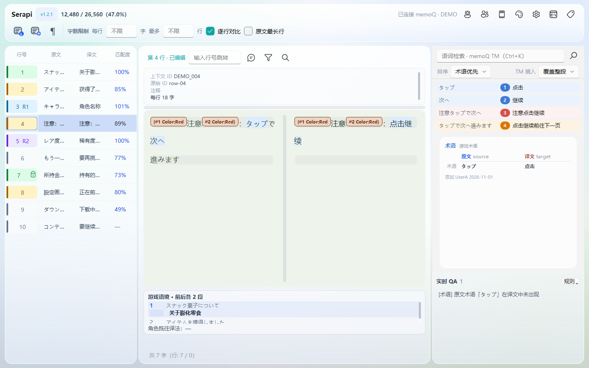

# Serapi

**少切几次窗口，多翻一句。**

Serapi 是一个 Windows 桌面工具，配合 memoQ WebTrans 使用。它把段落、原文、译文、翻译记忆、术语和段信息放在同一屏，让你把注意力放回译文。

[下载 Windows 版](https://github.com/Mameko230/serapi/releases/latest) · [三步开始](#三步开始)

免费 · 开源（MIT） · v1.2.1 · Windows 10/11 · 独立程序，不是浏览器插件 · 需要你自己的 memoQ WebTrans 账号



> Serapi 是非官方第三方工具，与 memoQ Zrt. 没有关联，也未获其授权。memoQ 是其所有者的商标。Serapi 不绕过 memoQ，读写通过 memoQ 页面自己的接口完成。

## 翻译时，你可能一直在做这些小动作

- 在段落、原文、译文和术语之间来回切换。
- 对着满屏 Tag 符号反复确认：这里到底有没有漏？
- 写完一段才发现字数超了，或者该用的术语没用上。
- 想查一个词，却要先离开当前句，找窗口、找面板、再找回来。

这些动作本身不复杂，但一天下来，会吃掉很多本该用在译文上的注意力。

Serapi 把这些动作收进一个窗口里，让你从打开文档到翻完一句，少被打断几次。

## 当前段需要的，都在视线里

### 1. 当前段放在正中间

左边是段列表；中间是原文和译文，段信息在译文上方；右边是翻译记忆、术语和实时检查（QA）。
不用在几个窗口之间来回找，正在翻的这一句始终在视线中央。

- 长文档可以按行号跳转，也可以只显示想看的行。
- 当前段前后各两段会一直显示（只限已经加载的行），换段时不容易丢掉上下文。
- 编辑区字号可以在 12–28 之间调整，原文和译文一起变。

### 2. Tag 变成看得懂的胶囊

Tag 在编辑器里显示成有颜色、带文字的胶囊。
换行、颜色标记、粗体、斜体、下划线、占位符，都能一眼看出是什么。

- 按 `F9` 插入原文里还缺的下一个 Tag，不用自己来回对照。
- 已经有的同类 Tag 不会重复插入。

### 3. 写完就检查，不用等到最后

编辑当前段时，Serapi 会顺手检查这些容易漏掉的地方：

- 字数和行数有没有超过限制；
- Tag 数量和原文对不对得上；
- 原文里该用的术语，译文里有没有漏掉；
- 原文里的数字，译文里有没有漏掉或多出来；同一行里全角/半角数字有没有混用。

检查只做提醒，不会自动改你的译文。不需要的规则可以逐条关掉。

### 4. 查词和术语，不用离开当前句

- 翻译记忆（TM）和术语库命中就在右边，双击或按 `Ctrl+1…9` 插入。
- 按 `Ctrl+K` 在翻译记忆里查这个词出现过的句子，结果可以只插一部分，也可以整条插入。
- 按 `Ctrl+D` 查本地词典；查询日语词时会把常见变形还原，释义按简体显示。按 `Ctrl+Shift+D` 可以把选区收进个人词库。

本地词典、草稿和个人词库只留在这台电脑上。翻译记忆（TM）和术语库（TB）命中、语词检索则和网页版一样，由你自己的 memoQ 服务器返回。

## 按你的习惯来

- 界面有蓝色、青绿、紫罗兰、暖橙和深色主题；编辑器还有浅色、米色、护眼绿等配色。
- 切换段落会自动保存草稿；`Ctrl+S` 只保存，`Ctrl+Enter` 保存并确认。
- 第一次使用填入自己的 memoQ 服务器地址，之后可以随时切换；地址和名称只保存在本机。

## 适合谁

如果你经常在 memoQ WebTrans 里处理带 Tag 的游戏文本、日文项目，或者每天要在一个长文档里反复对照术语，Serapi 会更省力。

如果你只是偶尔改一两句，memoQ 网页本身可能已经够用。

它不替代 memoQ，也不改变你的项目流程。账号、服务器、确认和交付方式都不变，只是多了一个更顺手的桌面工作区。

## 三步开始

1. **下载并安装**：打开 [最新版本](https://github.com/Mameko230/serapi/releases/latest)，下载并运行 `Serapi-Setup.exe`。不需要另外安装 Python。
2. **连接你的 memoQ**：第一次打开时，填入你的 memoQ WebTrans 地址（形如 `https://your-server/memoqweb`），登录你的账号。
3. **打开文档，开始翻译**：点开一段，中间是原文和译文（上方是段信息），右边是翻译记忆和术语；需要查词时再用快捷键。

> 也可以下载便携版 zip，解压后直接运行。安装版包含可选的日语词典组件，便携版不带内置词典，可手动指定词典目录。

## 你可能会问

**Serapi 收费吗？**
免费，开源，使用 MIT 许可证。

**会把我的译文或项目内容上传到别处吗？**
本地词典、草稿和个人词库只在这台电脑上；TM/TB 命中和语词检索会向你的 memoQ 服务器请求，和网页版一致。Serapi 没有中转服务器，也没有遥测；每天一次更新检查只访问 GitHub 公开 API，不携带项目内容。

**它会替代 memoQ 吗？**
不会。Serapi 不绕过 memoQ，也不另存一套项目。确认、拒绝和写回仍然走 memoQ 的流程。

**需要装 Python 吗？**
使用安装包不需要。只有从源码运行才需要 Python 3.14 或更高版本。

**新版和旧版 memoQ WebTrans 都能用吗？**
新版是主要支持对象；旧版保留基础能力，个别功能（例如添加术语的 `Ctrl+E`）只在旧版可用。

**支持哪些系统？**
Windows 10 / 11。

## English summary

Serapi is a small Windows companion for memoQ WebTrans. It puts the segment list, source, target, translation memories, terms and segment details on one screen, so you can spend less time switching windows and more time on the sentence you are translating. It uses your existing memoQ server and account, and does not replace memoQ. It is free and open source (MIT), and runs on Windows 10/11.

[Download for Windows](https://github.com/Mameko230/serapi/releases/latest)

Serapi is an unofficial third-party tool, not affiliated with or endorsed by memoQ Zrt. memoQ is a trademark of its owner.

## 开发与源码

- 普通用户：直接下载安装包，不需要安装 Python。
- 开发者与贡献者：先看 [AGENTS.md](AGENTS.md) 与 [docs/AGENT_CHECKLIST.md](docs/AGENT_CHECKLIST.md)。
- 项目边界、开发计划和测试说明：[ROADMAP.md](ROADMAP.md)、[CONTRIBUTING.md](CONTRIBUTING.md)、[TESTING.md](TESTING.md)、[docs/SMOKE.md](docs/SMOKE.md)。
- 待做需求清单：[docs/BACKLOG.md](docs/BACKLOG.md)。
- 桥接与页面结构：[docs/BRIDGE_CONTRACT.md](docs/BRIDGE_CONTRACT.md)。

## 从源码运行

环境要求：Windows 10/11、Python 3.14 或更高版本。

1. 安装 Python 3.14+（安装时勾选 Add to PATH）。
2. 双击 `启动Serapi.bat`：首次会创建 `.venv` 并安装依赖，然后启动。
3. 也可以手动运行：

```bat
py -3 -m venv .venv
.venv\Scripts\python.exe -m pip install -r requirements.txt
.venv\Scripts\python.exe -m app.main
```

依赖使用最低版本约束，允许跟随更新：

```text
PyQt6>=6.12.1
PyQt6-WebEngine>=6.140.1
PyQt6-Fluent-Widgets>=1.11.3
```

配置目录沿用历史路径 `~/.memodesk/`（含登录态、草稿、Tag 规则），从旧版本升级到 Serapi 不会丢数据；这是内部兼容路径，不是项目名的延续。

## 快捷键

| 快捷键 | 作用 |
|---|---|
| Ctrl+S | 只保存当前段 |
| Ctrl+Enter | 保存并确认，跳下一段 |
| Ctrl+K | 语词检索 |
| Ctrl+D | 本地词典查询（个人库优先） |
| Ctrl+Shift+D | 捕获选区到个人词库 |
| Ctrl+G | 按行号跳转 |
| F9 | 插入下一个缺失 Tag |
| Ctrl+1…9 | 插入列表中第 N 条 TM/术语 |
| Esc | 关闭当前面板 |

## 测试

日常改动先跑快速子集，提交前/发版前再跑全量：

```bash
python tests/run_all.py --fast
python tests/run_all.py --full
```

只跑受影响测试：

```bash
python tests/run_all.py --only test_seg_nav.py --only test_filter.js
```

测试全部离线，不访问 memoQ，不使用真实项目内容。分层规则、改动到测试的映射见 [TESTING.md](TESTING.md)。

## 架构概览

> 技术细节主要在开发文档中；这里保留入口，方便接手代码的人快速定位。

- 页面桥接：`app/bridge.js` 与 `app/*_api.js` / `app/*_model.js`。
- Qt 主窗口与端口：`app/mainwindow.py`、`app/qtedit.py`、`app/editor_backend.py`。
- 保存 / 读取 / 行操作工作流：`app/save_coordinator.py`、`app/read_workflow.py`、`app/row_workflow.py`。
- 文档统计 / 过滤 / 选择：`app/stats_filter_workflow.py`。
- 行导航与行操作前置条件：`app/row_navigation.py`、`app/row_actions.py`。
- 术语模型与服务：`app/terms_model.js`、`app/terms_api.js`。
- 完整架构、拆分原则与模块职责见 [docs/BRIDGE_CONTRACT.md](docs/BRIDGE_CONTRACT.md) 和 [HANDOFF.md](HANDOFF.md)。

## 结构与拆分原则

- `mainwindow.py` 只做 UI 装配与端口；新逻辑放独立模块/coordinator。
- `bridge.js` 只做页面门面；新 REST/状态/领域逻辑放 `app/*_api.js` / `app/*_model.js`。
- 新功能必须补独立测试；全量 `tests/run_all.py --full` 通过。
- 不允许提高 `tests/test_architecture_limits.py` 的行数上限；只能在拆分后下调。
- 页面选择器只能改 `app/page_rules.json`，并同步 fixture。

## 隐私与安全

- 不收集遥测，不自动上传项目内容。
- 更新检查只访问 GitHub 公开 API；只提示版本和说明，不自动下载。
- 读写通过 memoQ 页面自己的接口；确认、拒绝和写回仍走 memoQ 的流程。
- 本地词典、草稿和个人词库存放在本机 `~/.memodesk/`，不会上传。

## 已知限制

- 只在 Windows 10/11 + README 中列出的依赖组合上验证。
- 桥接依赖 memoQ WebTrans 页面结构；memoQ 升级后可能需要更新选择器规则。
- 新版页面的上下文/注释/字数限制来自预览 HTML；解析不到时显示“新版不提供/—”，不会伪造 ID。
- 实时 QA 只检查当前段缓存：数字、Tag 差额、全半角数字、TB 术语未采用、行长/行数；不检查 Tag 位置，不比较跨段术语一致性。
- 结构操作（lock/clear/split/join）已有接口，但 UI 入口尚未开放。
- 旧版编辑器保留基础能力；个别新版功能在旧版不可用。

详见 [docs/LIMITATIONS.md](docs/LIMITATIONS.md)。

## 发版前流程（固定）

1. `python tests/run_all.py --full` 全绿。
2. 检查打包清单与 `docs/RELEASE_CHECKLIST.md`。
3. 在打包安装包上跑 `docs/SMOKE.md`。
4. 改 `app/version.py` 的 `APP_VERSION`，提交，打同名 tag 推送。
5. CI 自动构建 Windows 安装包和便携版，并附到 GitHub Release。

## License

MIT，见 [LICENSE](LICENSE)。
